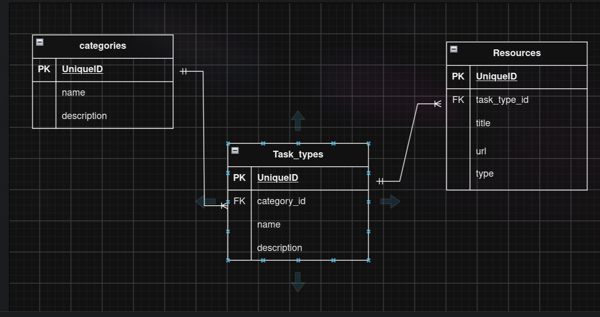

# cyberoad

## Опис і призначення

**cyberoad** це roadmap для підготовки до ctf-змагань, на кожну категорію має типи завдань і до кожного типу містить посилання на статті / відео на ютубі щоб вивчити цю тему. 

## Як запустити проєкт

Потрібен Python 3.12 або новіший.

1. Склонуйте репозиторій і перейдіть у теку:

   ```bash
   git clone https://github.com/limitation-perception/cybersec_roadmap.git
   cd cybersec_roadmap
   ```

2. Створіть віртуальне оточення і встановіть залежності:

   ```bash
   python -m venv .venv
   source .venv/bin/activate
   pip install -r requirements.txt
   ```

3. Створіть файл `.env` з налаштуваннями середовища (детально в розділі [Змінні середовища](#змінні-середовища)):

   ```bash
   cp .env.example .env
   ```

   Згенеруйте секретний ключ і вставте його в `.env` замість `change-me-to-a-long-random-string` у рядку `SECRET_KEY=`:

   ```bash
   python -c "from django.core.management.utils import get_random_secret_key; print(get_random_secret_key())"
   ```

4. Застосуйте міграції:

   ```bash
   python manage.py migrate
   ```

5. Запустіть сервер:

   ```bash
   python manage.py runserver
   ```

API буде доступне за адресою http://127.0.0.1:8000.

Фронтенд лежить в окремому репозиторії [cyberoad_front](https://github.com/limitation-perception/cyberoad_front) і запускається на http://localhost:5173. Адреси, з яких бекенд дозволяє запити (CORS), задаються змінною `CORS_ALLOWED_ORIGINS` у `.env`.

## Змінні середовища

Конфіденційні дані й налаштування, що залежать від середовища, не зберігаються в коді. Django читає їх зі змінних середовища або з файлу `.env` у корені проєкту за допомогою бібліотеки [python-decouple](https://github.com/HBNetwork/python-decouple) (див. [config/settings.py](config/settings.py)).

- **`.env`** — ваші справжні значення. Файл додано в `.gitignore`, тому він ніколи не потрапляє в git. Не надсилайте його нікому.
- **[.env.example](.env.example)** — шаблон із переліком усіх змінних і заглушками замість секретів. Він лежить у репозиторії, щоб було видно, що треба налаштувати.

| Змінна | Обов'язкова | Що означає | Приклад для локальної розробки |
|---|---|---|---|
| `SECRET_KEY` | так | секретний ключ Django: ним підписуються JWT токени і сесії. Має бути довгим, випадковим і своїм для кожного середовища | згенерований командою з кроку 3 |
| `DEBUG` | ні (за замовчуванням `False`) | режим розробки: детальні сторінки помилок і `DEBUG`-логи. На сервері має бути `False` | `True` |
| `ALLOWED_HOSTS` | ні (за замовчуванням порожньо) | домени, з яких сервер приймає запити, через кому. Порожнє значення при `DEBUG=True` дозволяє лише localhost, а при `DEBUG=False` сервер не запуститься | `localhost,127.0.0.1` |
| `CORS_ALLOWED_ORIGINS` | так | адреси фронтенду, яким дозволено звертатися до API з браузера, через кому, з протоколом і портом | `http://localhost:5173,http://127.0.0.1:5173` |

Якщо обов'язкової змінної немає ні в `.env`, ні в середовищі, Django не запуститься і покаже, якої саме бракує, наприклад:

```
decouple.UndefinedValueError: SECRET_KEY not found. Declare it as envvar or define a default value.
```

Змінні середовища мають пріоритет над `.env`: наприклад, `DEBUG=False python manage.py runserver` запустить сервер без режиму розробки, не змінюючи файл.

База даних — SQLite (файл `db.sqlite3` у корені проєкту, теж у `.gitignore`), тому логіна й пароля до неї немає.

## Документація API (OpenAPI)

Документація генерується автоматично з коду бібліотекою [drf-spectacular](https://drf-spectacular.readthedocs.io/) у форматі OpenAPI 3. Вона завжди відповідає поточному коду: схема будується з views і serializers під час кожного запиту.

Після запуску сервера:

| Що | Адреса |
|---|---|
| Swagger UI | http://127.0.0.1:8000/api/docs/ |
| OpenAPI-схема (YAML) | http://127.0.0.1:8000/api/schema/ |

### Що задокументовано

Усі ендпоінти: автентифікація (`/auth/...`), категорії, типи завдань і ресурси. Для кожного вказано:

- опис, HTTP-метод і параметри шляху (`id`);
- структуру тіла запиту й відповіді;
- можливі статуси (`200`, `201`, `204`, `400`, `401`, `404`, `409`) з форматом помилок;
- чи потрібен токен: ендпоінти, що потребують автентифікації, позначені замком.

Найдетальніше описані **категорії** (ресурс, покритий тестами) і `/auth/register`, `/auth/login`, `/auth/refresh`: для них є приклади запитів і кожної відповіді, включно з помилками.

Описи форматів помилок і спільні відповіді (`401`, `404`, `409`) лежать у [roadmap/schema.py](roadmap/schema.py), опис кожного ендпоінта — у декораторах `@extend_schema` над методами у [roadmap/views.py](roadmap/views.py) і [users/views.py](users/views.py).

### Як надсилати запити зі Swagger UI

1. Відкрийте `POST /auth/login` → **Try it out**, введіть `username` і `password` → **Execute**. Скопіюйте `access` з відповіді.
2. Натисніть **Authorize** угорі сторінки, вставте `access` токен (без слова `Bearer`) → **Authorize**.
3. Тепер запити, позначені замком (`POST`, `PUT`, `DELETE`), надсилаються з токеном. Через 15 хвилин токен прострочиться: отримайте новий через `/auth/login` або `/auth/refresh`.

### Як отримати OpenAPI-схему

- Відкрийте http://127.0.0.1:8000/api/schema/ (YAML). Щоб отримати JSON, додайте `?format=json`: http://127.0.0.1:8000/api/schema/?format=json
- Або згенеруйте файл без запуску сервера:

  ```bash
  python manage.py spectacular --file schema.yml
  ```

  Додайте `--validate`, щоб заодно перевірити схему на відповідність стандарту OpenAPI.

Схему можна імпортувати в Postman (**Import** → файл або посилання на `/api/schema/`) чи інші інструменти, що підтримують OpenAPI.

## Логування

Логування налаштоване стандартним модулем Python `logging` через словник `LOGGING` у [config/settings.py](config/settings.py).

### Куди пишуться логи

| Куди | Що потрапляє |
|---|---|
| консоль (термінал з `runserver`) | усе від `DEBUG` для коду проєкту (`DEBUG` лише коли `DEBUG = True`), `WARNING` і вище від Django, рядки доступу `runserver` |
| файл `logs/app.log` | від `INFO` і вище, без рядків доступу. Файл ротується: до 1 МБ, зберігаються 3 попередні копії (`app.log.1`…`app.log.3`) |

Тека `logs/` створюється автоматично під час запуску і не потрапляє в git.

Формат рядка: час, рівень, логер (модуль), повідомлення:

```
2026-11-15 07:42:34 INFO roadmap.views Category created: id=12 'LogTest' by user_id=15
2026-11-15 07:42:34 WARNING roadmap.views Category delete refused: id=12 has 1 task type(s) (user_id=15)
2026-11-15 07:42:33 WARNING users.views Failed login: username='alice'
```

### Що і з яким рівнем логується

| Рівень | Подія |
|---|---|
| `DEBUG` | скільки об'єктів повернули списки (`/categories`, `/task-types`, `/resources`); успішне оновлення access токена |
| `INFO` | створення, редагування й видалення категорії, типу завдання чи ресурсу: `id`, назва і `user_id`, хто це зробив; реєстрація нового користувача; успішний логін |
| `WARNING` | невалідні дані (`400`): які саме поля не пройшли перевірку; відмова у видаленні через пов'язані записи (`409`); невдалий логін; невалідний або прострочений refresh токен; відповіді `4xx` (логер Django `django.request`: метод і шлях) |
| `ERROR` | необроблені помилки сервера (`500`) з traceback (логер Django `django.request`) |

### Що свідомо не логується

- паролі: ні при реєстрації, ні при логіні, навіть неправильні;
- access і refresh токени, заголовок `Authorization`;
- значення полів з невалідними даними: логуються лише **назви** полів (наприклад, `fields ['email', 'password']`), бо в значеннях можуть бути чутливі дані;
- email користувачів: для ідентифікації достатньо `user_id` або `username`;
- тіла запитів і відповідей цілком.

Тести в [users/tests.py](users/tests.py) і [roadmap/tests.py](roadmap/tests.py) перевіряють, що потрібні події потрапляють у лог, а паролі, токени і значення невалідних полів — ні.

## Тести

Автоматизованими тестами покрито ресурс **категорій** (`/categories`). Тести написані на [pytest](https://docs.pytest.org/) з плагіном [pytest-django](https://pytest-django.readthedocs.io/), покриття рахує [pytest-cov](https://pytest-cov.readthedocs.io/) (обгортка над coverage.py).

### Як запустити

Усі інструменти вже є в `requirements.txt`. Тестам потрібні ті самі налаштування, що й серверу, тож спершу виконайте кроки 2 і 3 з розділу [Як запустити проєкт](#як-запустити-проєкт) (залежності і файл `.env`). Запускайте з кореня проєкту з активованим віртуальним оточенням:

```bash
source .venv/bin/activate
```

Усі тести:

```bash
pytest
```

Детальний вивід, з назвою кожного тесту:

```bash
pytest -v
```

Тести з покриттям, з номерами рядків, які тести не зачепили:

```bash
pytest --cov --cov-report=term-missing
```

HTML-звіт покриття (відкрийте `htmlcov/index.html` у браузері, там видно кожен рядок коду):

```bash
pytest --cov --cov-report=html
```

Окремий тест або група тестів за назвою:

```bash
pytest roadmap/tests.py::test_delete_category_with_task_types_returns_409
pytest -k delete
```

Сервер запускати не потрібно. pytest-django створює окрему тимчасову базу даних для тестів і видаляє її після запуску, тому `db.sqlite3` тести не змінюють.

### Що перевіряється

| Метод | Позитивні сценарії | Негативні сценарії |
|---|---|---|
| `GET /categories`, `GET /categories/{id}`, `GET /categories/{id}/task-types` | гість отримує список (з даними і порожній), одну категорію, типи завдань категорії | неіснуюча категорія → `404` |
| `POST /categories` | авторизований користувач створює категорію → `201` | без токена, з невалідним і з простроченим токеном → `401`; без назви, з порожньою або задовгою назвою, дублікат назви → `400` |
| `PUT /categories/{id}` | авторизований користувач редагує категорію → `200` | без токена → `401`; неіснуюча категорія → `404`; невалідні дані → `400` |
| `DELETE /categories/{id}` | авторизований користувач видаляє порожню категорію → `204` | без токена → `401`; неіснуюча категорія → `404`; категорія з типами завдань → `409` |

Окрім статусу відповіді, тести перевіряють стан бази: наприклад, що після `401` категорія не створилась і не змінилась, а після `409` не видалилась.

Тести логування перевіряють, що створення категорії, невалідні дані, відмова у видаленні, реєстрація, логін і невдалий refresh записуються в лог з правильним рівнем, а паролі, токени і значення невалідних полів у лог не потрапляють.

Окремі тести перевіряють документацію API: OpenAPI-схема і Swagger UI відкриваються, у схемі є всі методи категорій, а замок (вимога токена) стоїть лише на методах, що змінюють дані, як і в реальних правах доступу.

### Фікстури

Тестові дані готуються фікстурами в [conftest.py](conftest.py):

| Фікстура | Що готує |
|---|---|
| `api_client` | клієнт без токена (неавторизований користувач) |
| `user` | користувач у тестовій базі |
| `auth_client` | клієнт із валідним JWT access токеном користувача |
| `expired_token_client` | клієнт із простроченим access токеном |
| `category` | категорія `Web` |
| `category_with_task_type` | категорія, до якої прив'язаний тип завдання (її не можна видалити) |

### Файли

| Файл | Що в ньому |
|---|---|
| [pytest.ini](pytest.ini) | налаштування pytest: модуль налаштувань Django і які файли вважати тестами |
| [conftest.py](conftest.py) | фікстури |
| [roadmap/tests.py](roadmap/tests.py) | тести категорій, документації API і логування операцій |
| [users/tests.py](users/tests.py) | тести логування реєстрації, логіну й refresh |
| [.coveragerc](.coveragerc) | налаштування покриття: рахується лише код проєкту (`config`, `roadmap`, `users`), без міграцій і самих тестів |

## Postman

Колекція з усіма ендпоінтами лежить у [postman/cyberoad.postman_collection.json](postman/cyberoad.postman_collection.json) (формат Collection v2.1).

- Імпортуйте її в Postman: **Import** → оберіть файл.
- Адреса сервера задана в змінній колекції `{{base_url}}` (за замовчуванням `http://127.0.0.1:8000`).
- Першою йде папка **Auth**: `Register` створює нового користувача з випадковим іменем, `Login` зберігає токени в змінні `access_token` і `refresh_token`, `Refresh` оновлює `access_token`.
- На рівні колекції налаштовано **Authorization → Bearer Token** зі значенням `{{access_token}}`, тому всі запити, крім папки **Auth**, автоматично передають токен.
- Запускайте папки по черзі або всю колекцію через **Run collection**: запити на створення зберігають `id` у змінні `category_id`, `task_type_id` і `resource_id`.
- Папка **Errors** містить запити, що повертають помилки `400`, `401`, `404` і `409`.

## Автентифікація (JWT)

Автентифікація зроблена на JSON Web Token через бібліотеку [djangorestframework-simplejwt](https://django-rest-framework-simplejwt.readthedocs.io/). Код лежить в окремому застосунку `users`.

### Як передавати токен

Для запитів, які змінюють дані, додайте заголовок:

```
Authorization: Bearer <access>
```

`<access>` це токен з відповіді `POST /auth/login` або `POST /auth/refresh`. Між `Bearer` і токеном рівно один пробіл.

### Два токени і як оновлюється access

| Токен | Скільки живе | Для чого |
|---|---|---|
| `access` | 15 хвилин | передається в заголовку `Authorization` у кожному запиті, що потребує авторизації |
| `refresh` | 1 день | тільки для отримання нового `access` через `POST /auth/refresh` |

Час життя задано в `SIMPLE_JWT` у [config/settings.py](config/settings.py).

Як це працює на клієнті:

1. `POST /auth/login` повертає `access` і `refresh`. Клієнт зберігає обидва.
2. Кожен запит, що змінює дані, клієнт надсилає з `Authorization: Bearer <access>`.
3. Через 15 хвилин `access` прострочується, і сервер відповідає `401` з `"code": "token_not_valid"`.
4. Клієнт робить `POST /auth/refresh` з `refresh`, отримує новий `access` і повторює запит, який не пройшов.
5. Коли прострочується і `refresh` (через 1 день), `/auth/refresh` теж повертає `401`. Тоді користувач логіниться знову.

Навіщо два токени: `access` передається з кожним запитом, тому живе недовго, і якщо його перехоплять, він швидко стане непридатним. `refresh` передається тільки на один ендпоінт.

### Logout

Окремого ендпоінта для виходу немає. JWT не зберігається на сервері, тож під час виходу клієнт просто видаляє збережені `access` і `refresh`. Без токенів користувач знову неавторизований.

### Права доступу

Діє для всіх ендпоінтів через `DEFAULT_PERMISSION_CLASSES` (`IsAuthenticatedOrReadOnly`) у [config/settings.py](config/settings.py):

| Що | Хто може |
|---|---|
| `GET` (перегляд категорій, типів завдань, ресурсів) | усі, без токена |
| `POST`, `PUT`, `DELETE` | лише авторизовані користувачі (з `access` токеном) |
| `POST /auth/register`, `/auth/login`, `/auth/refresh` | усі, без токена |

Запит без токена або з невалідним чи простроченим токеном на ендпоінт, що потребує авторизації, отримує `401 Unauthorized` і заголовок `WWW-Authenticate: Bearer realm="api"`.

## Формат помилок

Усі помилки повертаються в однаковому форматі з ключем `detail`.

Невалідні дані (`400 Bad Request`), помилки по кожному полю в `errors`:

```json
{
  "detail": "Invalid data.",
  "errors": {
    "url": ["Enter a valid URL."],
    "type": ["\"podcast\" is not a valid choice."]
  }
}
```

Немає авторизації (`401 Unauthorized`). Запит без заголовка `Authorization`:

```json
{ "detail": "Authentication credentials were not provided." }
```

Невалідний або прострочений токен:

```json
{
  "detail": "Given token not valid for any token type",
  "code": "token_not_valid",
  "messages": [
    { "token_class": "AccessToken", "token_type": "access", "message": "Token is invalid" }
  ]
}
```

Для простроченого токена в `message` буде `"Token is expired"`.

Об'єкт не знайдено (`404 Not Found`):

```json
{ "detail": "No Category matches the given query." }
```

Видалення, яке порушує зв'язки (`409 Conflict`). Категорію не можна видалити, поки в ній є типи завдань, а тип завдання, поки до нього прив'язані ресурси:

```json
{ "detail": "Cannot delete category: it has 3 task type(s). Delete them first." }
```

Чому `409`: сам запит коректний і об'єкт існує, але видалення конфліктує з поточним станом даних, бо до об'єкта прив'язані інші записи.

## Ендпоінти

Ендпоінти, позначені **🔒**, потребують заголовка `Authorization: Bearer <access>`. Без нього вони повертають `401 Unauthorized`.

### Автентифікація

#### `POST /auth/register` - реєстрація

- **Request body:**

| Поле | Обов'язкове | Обмеження |
|---|---|---|
| `username` | так | до 150 символів, лише літери, цифри і `@ . + - _`, унікальний |
| `first_name` | ні, можна порожнім | до 150 символів |
| `last_name` | ні, можна порожнім | до 150 символів |
| `email` | так | коректний формат `name@example.com`, до 254 символів |
| `password` | так | до 128 символів, мінімум 8, не надто поширений, не лише з цифр |
| `password_confirm` | так | має збігатися з `password` |

```json
{
  "username": "alice",
  "first_name": "Alice",
  "last_name": "",
  "email": "alice@example.com",
  "password": "Str0ng-Pass!",
  "password_confirm": "Str0ng-Pass!"
}
```

- **Response:** `201 Created`, `400 Bad Request`

Пароль у відповідь не повертається. У базі він зберігається тільки як хеш.

```json
{ "id": 1, "username": "alice", "first_name": "Alice", "last_name": "", "email": "alice@example.com" }
```

Приклади `400`:

```json
{
  "detail": "Invalid data.",
  "errors": {
    "email": ["Enter a valid email address."],
    "password": [
      "This password is too short. It must contain at least 8 characters.",
      "This password is too common.",
      "This password is entirely numeric."
    ]
  }
}
```

```json
{ "detail": "Invalid data.", "errors": { "password_confirm": ["Passwords do not match."] } }
```

```json
{ "detail": "Invalid data.", "errors": { "username": ["A user with that username already exists."] } }
```

#### `POST /auth/login` - логін, отримати токени

- **Request body:**

```json
{ "username": "alice", "password": "Str0ng-Pass!" }
```

- **Response:** `200 OK`, `400 Bad Request` (немає `username` або `password`), `401 Unauthorized` (неправильні дані)

```json
{ "refresh": "eyJhbGciOiJIUzI1NiIs...", "access": "eyJhbGciOiJIUzI1NiIs..." }
```

`401`:

```json
{ "detail": "No active account found with the given credentials" }
```

`400` повертає бібліотека simplejwt, тому формат трохи інший, без `detail`:

```json
{ "username": ["This field is required."], "password": ["This field is required."] }
```

#### `POST /auth/refresh` - новий access токен

- **Request body:**

```json
{ "refresh": "eyJhbGciOiJIUzI1NiIs..." }
```

- **Response:** `200 OK`, `401 Unauthorized` (refresh невалідний або прострочений)

```json
{ "access": "eyJhbGciOiJIUzI1NiIs..." }
```

`401`:

```json
{ "detail": "Token is invalid", "code": "token_not_valid" }
```

### Категорії, типи завдань, ресурси

#### `GET /categories` - список усіх категорій

- **Response:** `200 OK`

```json
[
  { "id": 1, "name": "Web", "description": "Вразливості вебзастосунків" },
  { "id": 2, "name": "Crypto", "description": "Криптографія" }
]
```

#### `GET /categories/{id}` - поточна категорія

- **Response:** `200 OK`, `404 Not Found`

```json
{ "id": 1, "name": "Web", "description": "Вразливості вебзастосунків" }
```

#### `POST /categories` - додати категорію 🔒

- **Headers:** `Authorization: Bearer <access>`

- **Request body:**

```json
{ "name": "Web", "description": "Вразливості вебзастосунків" }
```

- **Response:** `201 Created`, `400 Bad Request`, `401 Unauthorized`

```json
{ "id": 1, "name": "Web", "description": "Вразливості вебзастосунків" }
```

#### `PUT /categories/{id}` - редагувати категорію 🔒

- **Headers:** `Authorization: Bearer <access>`

- **Request body:**

```json
{ "name": "Web", "description": "Новий опис" }
```

- **Response:** `200 OK`, `400 Bad Request`, `401 Unauthorized`, `404 Not Found`

```json
{ "id": 1, "name": "Web", "description": "Новий опис" }
```

#### `DELETE /categories/{id}` - видалити категорію 🔒

- **Headers:** `Authorization: Bearer <access>`

- **Response:** `204 No Content`, `401 Unauthorized`, `404 Not Found`, `409 Conflict` (у категорії є типи завдань)

#### `GET /categories/{id}/task-types` - типи завдань однієї категорії

- **Response:** `200 OK`, `404 Not Found`

```json
[
  { "id": 1, "category": 1, "name": "SQL Injection", "description": "Впровадження SQL-коду в запит" },
  { "id": 2, "category": 1, "name": "XSS", "description": "Впровадження JavaScript на сторінку" }
]
```

#### `GET /task-types` - список усіх типів завдань

- **Response:** `200 OK`

```json
[
  { "id": 1, "category": 1, "name": "SQL Injection", "description": "Впровадження SQL-коду в запит" },
  { "id": 2, "category": 2, "name": "RSA", "description": "Атаки на RSA" }
]
```

#### `GET /task-types/{id}` - один тип завдання

- **Response:** `200 OK`, `404 Not Found`

```json
{ "id": 1, "category": 1, "name": "SQL Injection", "description": "Впровадження SQL-коду в запит" }
```

#### `POST /task-types` - додати тип завдання в категорію 🔒

- **Headers:** `Authorization: Bearer <access>`

- **Request body:**

```json
{ "category": 1, "name": "SQL Injection", "description": "Впровадження SQL-коду в запит" }
```

- **Response:** `201 Created`, `400 Bad Request`, `401 Unauthorized`

```json
{ "id": 1, "category": 1, "name": "SQL Injection", "description": "Впровадження SQL-коду в запит" }
```

#### `PUT /task-types/{id}` - редагувати тип завдання 🔒

- **Headers:** `Authorization: Bearer <access>`

- **Request body:**

```json
{ "category": 1, "name": "SQL Injection", "description": "Новий опис" }
```

- **Response:** `200 OK`, `400 Bad Request`, `401 Unauthorized`, `404 Not Found`

```json
{ "id": 1, "category": 1, "name": "SQL Injection", "description": "Новий опис" }
```

#### `DELETE /task-types/{id}` - видалити тип завдання 🔒

- **Headers:** `Authorization: Bearer <access>`

- **Response:** `204 No Content`, `401 Unauthorized`, `404 Not Found`, `409 Conflict` (у типу завдання є ресурси)

#### `GET /task-types/{id}/resources` - статті й відео до типу завдання

- **Response:** `200 OK`, `404 Not Found`

```json
[
  { "id": 1, "task_type": 1, "title": "SQL injection", "url": "https://portswigger.net/web-security/sql-injection", "type": "article" },
  { "id": 2, "task_type": 1, "title": "SQL Injection for beginners", "url": "https://www.youtube.com/watch?v=...", "type": "video" }
]
```

#### `GET /resources` - список усіх ресурсів

- **Response:** `200 OK`

```json
[
  { "id": 1, "task_type": 1, "title": "SQL injection", "url": "https://portswigger.net/web-security/sql-injection", "type": "article" },
  { "id": 2, "task_type": 2, "title": "RSA attacks", "url": "https://www.youtube.com/watch?v=...", "type": "video" }
]
```

#### `GET /resources/{id}` - один ресурс

- **Response:** `200 OK`, `404 Not Found`

```json
{ "id": 1, "task_type": 1, "title": "SQL injection", "url": "https://portswigger.net/web-security/sql-injection", "type": "article" }
```

#### `POST /resources` - додати статтю чи відео до типу завдання 🔒

- **Headers:** `Authorization: Bearer <access>`

- **Request body:**

```json
{ "task_type": 1, "title": "SQL injection", "url": "https://portswigger.net/web-security/sql-injection", "type": "article" }
```

- **Response:** `201 Created`, `400 Bad Request`, `401 Unauthorized`

```json
{ "id": 1, "task_type": 1, "title": "SQL injection", "url": "https://portswigger.net/web-security/sql-injection", "type": "article" }
```

#### `PUT /resources/{id}` - редагувати ресурс 🔒

- **Headers:** `Authorization: Bearer <access>`

- **Request body:**

```json
{ "task_type": 1, "title": "SQL injection", "url": "https://portswigger.net/web-security/sql-injection", "type": "article" }
```

- **Response:** `200 OK`, `400 Bad Request`, `401 Unauthorized`, `404 Not Found`

```json
{ "id": 1, "task_type": 1, "title": "SQL injection", "url": "https://portswigger.net/web-security/sql-injection", "type": "article" }
```

#### `DELETE /resources/{id}` - видалити ресурс 🔒

- **Headers:** `Authorization: Bearer <access>`

- **Response:** `204 No Content`, `401 Unauthorized`, `404 Not Found`

## Схема бази даних


