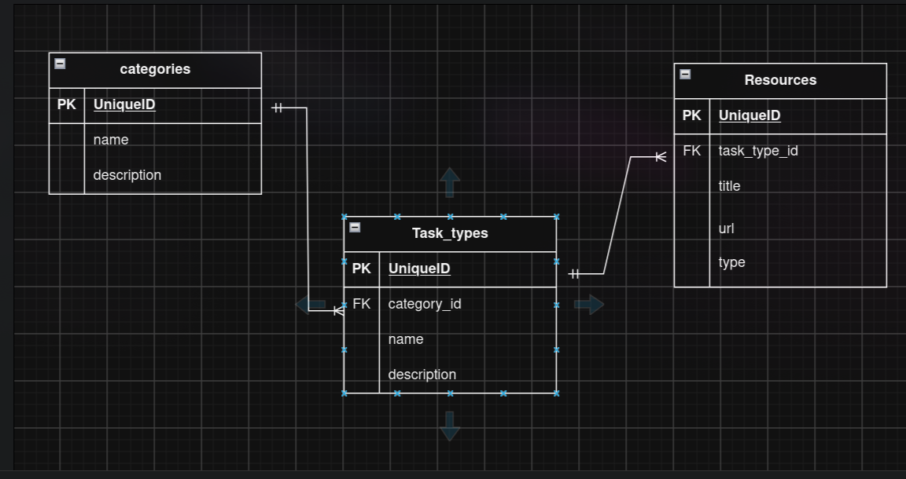

# cyberoad

## Опис і призначення

**cyberoad** це roadmap для підготовки до ctf-змагань, на кожну категорію має типи завдань і до кожного типу містить посилання на статті / відео на ютубі щоб вивчити цю тему. 

## Як запустити проєкт

Потрібен Python 3.12 або новіший.

1. Склонуйте репозиторій і перейдіть у теку:

   ```bash
   git clone https://github.com/limitation-perception/cybersec_roadmap.git
   cd cybersec_roadmap
   ```

2. Створіть віртуальне оточення і встановіть залежності:

   ```bash
   python -m venv .venv
   source .venv/bin/activate
   pip install -r requirements.txt
   ```

3. Застосуйте міграції:

   ```bash
   python manage.py migrate
   ```

4. Запустіть сервер:

   ```bash
   python manage.py runserver
   ```

API буде доступне за адресою http://127.0.0.1:8000.

Фронтенд лежить в окремому репозиторії [cyberoad_front](https://github.com/limitation-perception/cyberoad_front) і запускається на http://localhost:5173. CORS на бекенді дозволяє запити з `http://localhost:5173` і `http://127.0.0.1:5173`.

## Postman

Колекція з усіма ендпоінтами лежить у [postman/cyberoad.postman_collection.json](postman/cyberoad.postman_collection.json) (формат Collection v2.1).

- Імпортуйте її в Postman: **Import** → оберіть файл.
- Адреса сервера задана в змінній колекції `{{base_url}}` (за замовчуванням `http://127.0.0.1:8000`).
- Першою йде папка **Auth**: `Register` створює нового користувача з випадковим іменем, `Login` зберігає токени в змінні `access_token` і `refresh_token`, `Refresh` оновлює `access_token`.
- На рівні колекції налаштовано **Authorization → Bearer Token** зі значенням `{{access_token}}`, тому всі запити, крім папки **Auth**, автоматично передають токен.
- Запускайте папки по черзі або всю колекцію через **Run collection**: запити на створення зберігають `id` у змінні `category_id`, `task_type_id` і `resource_id`.
- Папка **Errors** містить запити, що повертають помилки `400`, `401`, `404` і `409`.

## Автентифікація (JWT)

Автентифікація зроблена на JSON Web Token через бібліотеку [djangorestframework-simplejwt](https://django-rest-framework-simplejwt.readthedocs.io/). Код лежить в окремому застосунку `users`.

### Як передавати токен

Для запитів, які змінюють дані, додайте заголовок:

```
Authorization: Bearer <access>
```

`<access>` це токен з відповіді `POST /auth/login` або `POST /auth/refresh`. Між `Bearer` і токеном рівно один пробіл.

### Два токени і як оновлюється access

| Токен | Скільки живе | Для чого |
|---|---|---|
| `access` | 15 хвилин | передається в заголовку `Authorization` у кожному запиті, що потребує авторизації |
| `refresh` | 1 день | тільки для отримання нового `access` через `POST /auth/refresh` |

Час життя задано в `SIMPLE_JWT` у [config/settings.py](config/settings.py).

Як це працює на клієнті:

1. `POST /auth/login` повертає `access` і `refresh`. Клієнт зберігає обидва.
2. Кожен запит, що змінює дані, клієнт надсилає з `Authorization: Bearer <access>`.
3. Через 15 хвилин `access` прострочується, і сервер відповідає `401` з `"code": "token_not_valid"`.
4. Клієнт робить `POST /auth/refresh` з `refresh`, отримує новий `access` і повторює запит, який не пройшов.
5. Коли прострочується і `refresh` (через 1 день), `/auth/refresh` теж повертає `401`. Тоді користувач логіниться знову.

Навіщо два токени: `access` передається з кожним запитом, тому живе недовго, і якщо його перехоплять, він швидко стане непридатним. `refresh` передається тільки на один ендпоінт.

### Logout

Окремого ендпоінта для виходу немає. JWT не зберігається на сервері, тож під час виходу клієнт просто видаляє збережені `access` і `refresh`. Без токенів користувач знову неавторизований.

### Права доступу

Діє для всіх ендпоінтів через `DEFAULT_PERMISSION_CLASSES` (`IsAuthenticatedOrReadOnly`) у [config/settings.py](config/settings.py):

| Що | Хто може |
|---|---|
| `GET` (перегляд категорій, типів завдань, ресурсів) | усі, без токена |
| `POST`, `PUT`, `DELETE` | лише авторизовані користувачі (з `access` токеном) |
| `POST /auth/register`, `/auth/login`, `/auth/refresh` | усі, без токена |

Запит без токена або з невалідним чи простроченим токеном на ендпоінт, що потребує авторизації, отримує `401 Unauthorized` і заголовок `WWW-Authenticate: Bearer realm="api"`.

## Формат помилок

Усі помилки повертаються в однаковому форматі з ключем `detail`.

Невалідні дані (`400 Bad Request`), помилки по кожному полю в `errors`:

```json
{
  "detail": "Invalid data.",
  "errors": {
    "url": ["Enter a valid URL."],
    "type": ["\"podcast\" is not a valid choice."]
  }
}
```

Немає авторизації (`401 Unauthorized`). Запит без заголовка `Authorization`:

```json
{ "detail": "Authentication credentials were not provided." }
```

Невалідний або прострочений токен:

```json
{
  "detail": "Given token not valid for any token type",
  "code": "token_not_valid",
  "messages": [
    { "token_class": "AccessToken", "token_type": "access", "message": "Token is invalid" }
  ]
}
```

Для простроченого токена в `message` буде `"Token is expired"`.

Об'єкт не знайдено (`404 Not Found`):

```json
{ "detail": "No Category matches the given query." }
```

Видалення, яке порушує зв'язки (`409 Conflict`). Категорію не можна видалити, поки в ній є типи завдань, а тип завдання, поки до нього прив'язані ресурси:

```json
{ "detail": "Cannot delete category: it has 3 task type(s). Delete them first." }
```

Чому `409`: сам запит коректний і об'єкт існує, але видалення конфліктує з поточним станом даних, бо до об'єкта прив'язані інші записи.

## Ендпоінти

Ендпоінти, позначені **🔒**, потребують заголовка `Authorization: Bearer <access>`. Без нього вони повертають `401 Unauthorized`.

### Автентифікація

#### `POST /auth/register` - реєстрація

- **Request body:**

| Поле | Обов'язкове | Обмеження |
|---|---|---|
| `username` | так | до 150 символів, лише літери, цифри і `@ . + - _`, унікальний |
| `first_name` | ні, можна порожнім | до 150 символів |
| `last_name` | ні, можна порожнім | до 150 символів |
| `email` | так | коректний формат `name@example.com`, до 254 символів |
| `password` | так | до 128 символів, мінімум 8, не надто поширений, не лише з цифр |
| `password_confirm` | так | має збігатися з `password` |

```json
{
  "username": "alice",
  "first_name": "Alice",
  "last_name": "",
  "email": "alice@example.com",
  "password": "Str0ng-Pass!",
  "password_confirm": "Str0ng-Pass!"
}
```

- **Response:** `201 Created`, `400 Bad Request`

Пароль у відповідь не повертається. У базі він зберігається тільки як хеш.

```json
{ "id": 1, "username": "alice", "first_name": "Alice", "last_name": "", "email": "alice@example.com" }
```

Приклади `400`:

```json
{
  "detail": "Invalid data.",
  "errors": {
    "email": ["Enter a valid email address."],
    "password": [
      "This password is too short. It must contain at least 8 characters.",
      "This password is too common.",
      "This password is entirely numeric."
    ]
  }
}
```

```json
{ "detail": "Invalid data.", "errors": { "password_confirm": ["Passwords do not match."] } }
```

```json
{ "detail": "Invalid data.", "errors": { "username": ["A user with that username already exists."] } }
```

#### `POST /auth/login` - логін, отримати токени

- **Request body:**

```json
{ "username": "alice", "password": "Str0ng-Pass!" }
```

- **Response:** `200 OK`, `400 Bad Request` (немає `username` або `password`), `401 Unauthorized` (неправильні дані)

```json
{ "refresh": "eyJhbGciOiJIUzI1NiIs...", "access": "eyJhbGciOiJIUzI1NiIs..." }
```

`401`:

```json
{ "detail": "No active account found with the given credentials" }
```

`400` повертає бібліотека simplejwt, тому формат трохи інший, без `detail`:

```json
{ "username": ["This field is required."], "password": ["This field is required."] }
```

#### `POST /auth/refresh` - новий access токен

- **Request body:**

```json
{ "refresh": "eyJhbGciOiJIUzI1NiIs..." }
```

- **Response:** `200 OK`, `401 Unauthorized` (refresh невалідний або прострочений)

```json
{ "access": "eyJhbGciOiJIUzI1NiIs..." }
```

`401`:

```json
{ "detail": "Token is invalid", "code": "token_not_valid" }
```

### Категорії, типи завдань, ресурси

#### `GET /categories` - список усіх категорій

- **Response:** `200 OK`

```json
[
  { "id": 1, "name": "Web", "description": "Вразливості вебзастосунків" },
  { "id": 2, "name": "Crypto", "description": "Криптографія" }
]
```

#### `GET /categories/{id}` - поточна категорія

- **Response:** `200 OK`, `404 Not Found`

```json
{ "id": 1, "name": "Web", "description": "Вразливості вебзастосунків" }
```

#### `POST /categories` - додати категорію 🔒

- **Headers:** `Authorization: Bearer <access>`

- **Request body:**

```json
{ "name": "Web", "description": "Вразливості вебзастосунків" }
```

- **Response:** `201 Created`, `400 Bad Request`, `401 Unauthorized`

```json
{ "id": 1, "name": "Web", "description": "Вразливості вебзастосунків" }
```

#### `PUT /categories/{id}` - редагувати категорію 🔒

- **Headers:** `Authorization: Bearer <access>`

- **Request body:**

```json
{ "name": "Web", "description": "Новий опис" }
```

- **Response:** `200 OK`, `400 Bad Request`, `401 Unauthorized`, `404 Not Found`

```json
{ "id": 1, "name": "Web", "description": "Новий опис" }
```

#### `DELETE /categories/{id}` - видалити категорію 🔒

- **Headers:** `Authorization: Bearer <access>`

- **Response:** `204 No Content`, `401 Unauthorized`, `404 Not Found`, `409 Conflict` (у категорії є типи завдань)

#### `GET /categories/{id}/task-types` - типи завдань однієї категорії

- **Response:** `200 OK`, `404 Not Found`

```json
[
  { "id": 1, "category": 1, "name": "SQL Injection", "description": "Впровадження SQL-коду в запит" },
  { "id": 2, "category": 1, "name": "XSS", "description": "Впровадження JavaScript на сторінку" }
]
```

#### `GET /task-types` - список усіх типів завдань

- **Response:** `200 OK`

```json
[
  { "id": 1, "category": 1, "name": "SQL Injection", "description": "Впровадження SQL-коду в запит" },
  { "id": 2, "category": 2, "name": "RSA", "description": "Атаки на RSA" }
]
```

#### `GET /task-types/{id}` - один тип завдання

- **Response:** `200 OK`, `404 Not Found`

```json
{ "id": 1, "category": 1, "name": "SQL Injection", "description": "Впровадження SQL-коду в запит" }
```

#### `POST /task-types` - додати тип завдання в категорію 🔒

- **Headers:** `Authorization: Bearer <access>`

- **Request body:**

```json
{ "category": 1, "name": "SQL Injection", "description": "Впровадження SQL-коду в запит" }
```

- **Response:** `201 Created`, `400 Bad Request`, `401 Unauthorized`

```json
{ "id": 1, "category": 1, "name": "SQL Injection", "description": "Впровадження SQL-коду в запит" }
```

#### `PUT /task-types/{id}` - редагувати тип завдання 🔒

- **Headers:** `Authorization: Bearer <access>`

- **Request body:**

```json
{ "category": 1, "name": "SQL Injection", "description": "Новий опис" }
```

- **Response:** `200 OK`, `400 Bad Request`, `401 Unauthorized`, `404 Not Found`

```json
{ "id": 1, "category": 1, "name": "SQL Injection", "description": "Новий опис" }
```

#### `DELETE /task-types/{id}` - видалити тип завдання 🔒

- **Headers:** `Authorization: Bearer <access>`

- **Response:** `204 No Content`, `401 Unauthorized`, `404 Not Found`, `409 Conflict` (у типу завдання є ресурси)

#### `GET /task-types/{id}/resources` - статті й відео до типу завдання

- **Response:** `200 OK`, `404 Not Found`

```json
[
  { "id": 1, "task_type": 1, "title": "SQL injection", "url": "https://portswigger.net/web-security/sql-injection", "type": "article" },
  { "id": 2, "task_type": 1, "title": "SQL Injection for beginners", "url": "https://www.youtube.com/watch?v=...", "type": "video" }
]
```

#### `GET /resources` - список усіх ресурсів

- **Response:** `200 OK`

```json
[
  { "id": 1, "task_type": 1, "title": "SQL injection", "url": "https://portswigger.net/web-security/sql-injection", "type": "article" },
  { "id": 2, "task_type": 2, "title": "RSA attacks", "url": "https://www.youtube.com/watch?v=...", "type": "video" }
]
```

#### `GET /resources/{id}` - один ресурс

- **Response:** `200 OK`, `404 Not Found`

```json
{ "id": 1, "task_type": 1, "title": "SQL injection", "url": "https://portswigger.net/web-security/sql-injection", "type": "article" }
```

#### `POST /resources` - додати статтю чи відео до типу завдання 🔒

- **Headers:** `Authorization: Bearer <access>`

- **Request body:**

```json
{ "task_type": 1, "title": "SQL injection", "url": "https://portswigger.net/web-security/sql-injection", "type": "article" }
```

- **Response:** `201 Created`, `400 Bad Request`, `401 Unauthorized`

```json
{ "id": 1, "task_type": 1, "title": "SQL injection", "url": "https://portswigger.net/web-security/sql-injection", "type": "article" }
```

#### `PUT /resources/{id}` - редагувати ресурс 🔒

- **Headers:** `Authorization: Bearer <access>`

- **Request body:**

```json
{ "task_type": 1, "title": "SQL injection", "url": "https://portswigger.net/web-security/sql-injection", "type": "article" }
```

- **Response:** `200 OK`, `400 Bad Request`, `401 Unauthorized`, `404 Not Found`

```json
{ "id": 1, "task_type": 1, "title": "SQL injection", "url": "https://portswigger.net/web-security/sql-injection", "type": "article" }
```

#### `DELETE /resources/{id}` - видалити ресурс 🔒

- **Headers:** `Authorization: Bearer <access>`

- **Response:** `204 No Content`, `401 Unauthorized`, `404 Not Found`

## Схема бази даних


