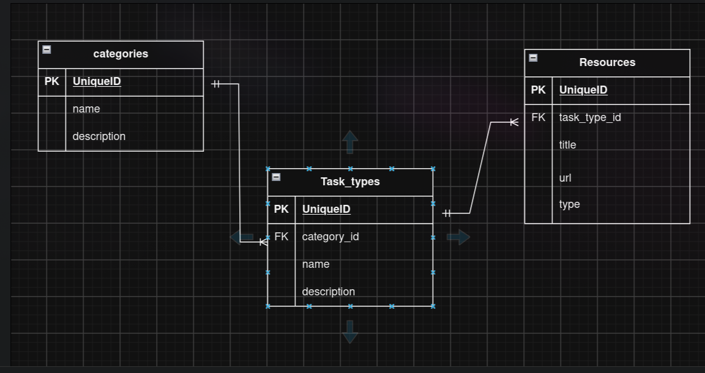

# cyberoad

## Опис і призначення

**cyberoad** це roadmap для підготовки до ctf-змагань, на кожну категорію має типи завдань і до кожного типу містить посилання на статті / відео на ютубі щоб вивчити цю тему. 

## Ендпоінти

#### `GET /categories` - список усіх категорій

- **Response:** `200 OK`

```json
[
  { "id": 1, "name": "Web", "description": "Вразливості вебзастосунків" },
  { "id": 2, "name": "Crypto", "description": "Криптографія" }
]
```

#### `GET /categories/{id}` - поточна категорія

- **Response:** `200 OK`, `404 Not Found`

```json
{ "id": 1, "name": "Web", "description": "Вразливості вебзастосунків" }
```

#### `POST /categories` - додати категорію

- **Request body:**

```json
{ "name": "Web", "description": "Вразливості вебзастосунків" }
```

- **Response:** `201 Created`, `400 Bad Request`

```json
{ "id": 1, "name": "Web", "description": "Вразливості вебзастосунків" }
```

#### `PUT /categories/{id}` - редагувати категорію

- **Request body:**

```json
{ "name": "Web", "description": "Новий опис" }
```

- **Response:** `200 OK`, `400 Bad Request`, `404 Not Found`

```json
{ "id": 1, "name": "Web", "description": "Новий опис" }
```

#### `DELETE /categories/{id}` - видалити категорію

- **Response:** `204 No Content`, `404 Not Found`

#### `GET /categories/{id}/task-types` - типи завдань однієї категорії

- **Response:** `200 OK`, `404 Not Found`

```json
[
  { "id": 1, "category_id": 1, "name": "SQL Injection", "description": "Впровадження SQL-коду в запит" },
  { "id": 2, "category_id": 1, "name": "XSS", "description": "Впровадження JavaScript на сторінку" }
]
```

#### `GET /task-types/{id}` - один тип завдання

- **Response:** `200 OK`, `404 Not Found`

```json
{ "id": 1, "category_id": 1, "name": "SQL Injection", "description": "Впровадження SQL-коду в запит" }
```

#### `POST /categories/{id}/task-types` - додати тип завдання в категорію

- **Request body:**

```json
{ "name": "SQL Injection", "description": "Впровадження SQL-коду в запит" }
```

- **Response:** `201 Created`, `400 Bad Request`, `404 Not Found`

```json
{ "id": 1, "category_id": 1, "name": "SQL Injection", "description": "Впровадження SQL-коду в запит" }
```

#### `PUT /task-types/{id}` - редагувати тип завдання

- **Request body:**

```json
{ "name": "SQL Injection", "description": "Новий опис" }
```

- **Response:** `200 OK`, `400 Bad Request`, `404 Not Found`

```json
{ "id": 1, "category_id": 1, "name": "SQL Injection", "description": "Новий опис" }
```

#### `DELETE /task-types/{id}` - видалити тип завдання

- **Response:** `204 No Content`, `404 Not Found`

#### `GET /task-types/{id}/resources` - статті й відео до типу завдання

```json
[
  { "id": 1, "task_type_id": 1, "title": "SQL injection", "url": "https://portswigger.net/web-security/sql-injection", "type": "article" },
  { "id": 2, "task_type_id": 1, "title": "SQL Injection for beginners", "url": "https://www.youtube.com/watch?v=...", "type": "video" }
]
```

#### `GET /resources/{id}` - один ресурс

- **Response:** `200 OK`, `404 Not Found`

```json
{ "id": 1, "task_type_id": 1, "title": "SQL injection", "url": "https://portswigger.net/web-security/sql-injection", "type": "article" }
```

#### `POST /task-types/{id}/resources` - додати статтю чи відео до типу завдання

- **Request body:**

```json
{ "title": "SQL injection", "url": "https://portswigger.net/web-security/sql-injection", "type": "article" }
```

- **Response:** `201 Created`, `400 Bad Request`, `404 Not Found`

```json
{ "id": 1, "task_type_id": 1, "title": "SQL injection", "url": "https://portswigger.net/web-security/sql-injection", "type": "article" }
```

#### `PUT /resources/{id}` - редагувати ресурс

- **Request body:**

```json
{ "title": "SQL injection", "url": "https://portswigger.net/web-security/sql-injection", "type": "article" }
```

- **Response:** `200 OK`, `400 Bad Request`, `404 Not Found`

```json
{ "id": 1, "task_type_id": 1, "title": "SQL injection", "url": "https://portswigger.net/web-security/sql-injection", "type": "article" }
```

#### `DELETE /resources/{id}` - видалити ресурс

- **Response:** `204 No Content`, `404 Not Found`


